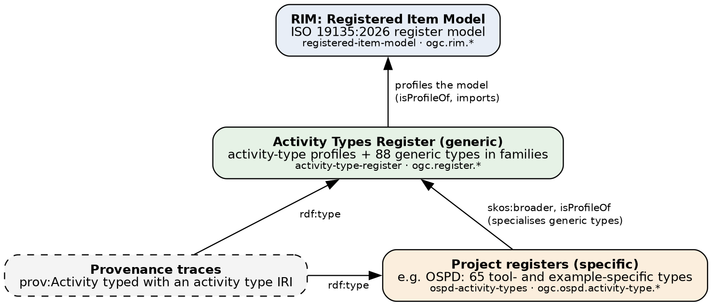

Provenance traces only work as linked data if the activity types they cite resolve to descriptions. This note explains how the activity type registers are layered, how a new project adds its own types, and how a project-specific type becomes a generic one.

# 1. The three layers

{ width=95% }

All repositories are under `github.com/ogcincubator`.

| Layer | Repository and block ids | What it holds |
|:------|:-------------------------|:--------------|
| **RIM** | `registered-item-model` (`ogc.rim.*`) | The Registered Item Model (ISO 19135:2026): registers, register items, statuses, governance. No activity types. Catalog: `w3id.org/ogc/rim/catalog`. |
| **Generic activity types** | `activity-type-register` (`ogc.register.*`) | The activity type profiles of the RIM (`acttype:ActivityType`, geoprocessing and ML profiles, JSON schemas) and the **generic activity types** (88), grouped into **families**: one block and one `skos:ConceptScheme` per family. |
| **Specific activity types** | one repository per project, e.g. `ospd-activity-types` (`ogc.ospd.activity-type.*`) | The types of one project: tool- or example-specific **specialisations** of generic types. OSPD has 65. |

**How they interact**

- *Building blocks:* a project register imports the generic register, which imports the RIM (`imports` in `bblocks-config.yaml`). Its root block is `isProfileOf bblocks://ogc.register.activity-types`, so the shapes of the activity type profile apply to every type it defines.
- *Linked data:* every type is a `skos:Concept` **and** an `acttype:ActivityType` (a `rim:RegisterItem`). A specific type points to its generic parent with `skos:broader`; the parent lives in another register and is resolved by IRI.
- *Hierarchy of abstraction:* family (concept scheme) → generic type → specific type. Generic types state *what* is done, independent of tools (`buffer`, `raster-reprojection`, `workflow`); specific types name a tool, product or workflow that does it (`sqlmm-buffer`, `mangrove-workflow`). The specific types stay as evidence of relevance for the generic one.
- *Publication:* each repository builds to GitHub Pages and uploads its ontologies and data to the shared triplestore behind the OSPD Prez instance, one graph per block, replaced on every build. The Prez shows three top-level catalogs: RIM, *Activity Types Register* and *OSPD Activity Types Register*.
- *Traces:* a `prov:Activity` is typed with the IRI of the most specific type that applies (`rdf:type`); queries can climb to the generic type through `skos:broader`.

**URIs.** Types are minted under `https://w3id.org/ogc/ospd/activity-type/<slug>`; generic and OSPD-specific types share this namespace for now, so a type keeps its IRI if it is promoted (section 3). Whether generic types should later move to a neutral namespace is open.

**Source of truth.** The current `data.ttl` files were generated once from the consolidation tables, which are published as snapshots in [`docs/analysis`](analysis/README.md). From now on they are edited **by hand**; do not regenerate them from the tables.

# 2. How a new project declares its own activity types

Example: project *Acme* defines `acme-flood-extent`.

1. **Create the register.** Use the OGC [`bblock-template`](https://github.com/opengeospatial/bblock-template) ("Use this template", not fork). Set `identifier-prefix: ogc.acme.activity-type.` and the imports:

   ```yaml
   imports:
     - default
     - https://ogcincubator.github.io/registered-item-model/
     - https://ogcincubator.github.io/activity-type-register/build/register.json
   ```

   To publish into the shared Prez, add the `sparql:` section (push endpoint, an own `graph`, `resources.data: true`) and the `sparql_username`/`sparql_password` secrets.
2. **Add a root block** (`_sources/core/`) with `isProfileOf: bblocks://ogc.register.activity-types`, a `data.ttl` with the register catalog, and SHACL shapes; copy those of `ospd-activity-types`. Add a second block (`_sources/specific/`, `isProfileOf` the root) for the concept scheme and the types.
3. **Pick the generic parent** of each type: browse the generic register in the Prez, or its families in `activity-type-register/_sources/generic/<family>/data.ttl`. Prefer the narrowest generic type that is still tool-neutral. If none fits, either leave the type without parent (the shapes only warn) and open a promotion request (section 3), or propose a new generic type.
4. **Define the type** in `data.ttl`:

   ```turtle
   @prefix skos:    <http://www.w3.org/2004/02/skos/core#> .
   @prefix rim:     <https://w3id.org/ogc/rim/> .
   @prefix acttype: <https://w3id.org/ogc/rim/activity-type/> .
   @prefix xsd:     <http://www.w3.org/2001/XMLSchema#> .
   @prefix acme:    <https://w3id.org/ogc/acme/activity-type/> .
   @prefix ospd:    <https://w3id.org/ogc/ospd/activity-type/> .

   acme:flood-extent a skos:Concept, acttype:ActivityType ;
       skos:inScheme acme:scheme ;
       skos:prefLabel "Flood extent"@en ;
       skos:definition "Delineates the flooded area from a SAR scene."@en ;
       skos:broader ospd:GA032 ;                    # generic parent: "Raster analysis"
       rim:itemClass acttype:activityTypeItemClass ;
       rim:objectIdentifier "https://w3id.org/ogc/acme/activity-type/flood-extent"^^xsd:anyURI ;
       rim:validityStatus rim:valid ;
       rim:publicationStatus rim:published .
   ```

   Required: the two types, `rim:itemClass`, `rim:objectIdentifier` and the two statuses (RIM shapes), `skos:prefLabel` and `skos:inScheme`. Recommended: `skos:definition` and `skos:broader`. Optional: `dcterms:source`, `rdfs:seeAlso`, `prov:qualifiedAttribution`, `skos:closeMatch` to similar types elsewhere.
5. **Choose the URI namespace.** Use the project's own w3id prefix (a pull request to `perma-id/w3id.org`, as done for `/ogc/ospd`). OSPD participants adding types to the OSPD register keep `.../ogc/ospd/activity-type/<slug>`.
6. **Build and publish.** `./build.sh`, fix validation errors, push to `main`: CI validates, deploys Pages and uploads the data. Cite the new IRI as the `rdf:type` of your `prov:Activity` instances.

# 3. Promoting a specific type to a generic one

*Proposed process, for Rob's review.* A type is a candidate when it is tool-neutral and used, or clearly needed, by more than one project or tool.

1. **Request.** Open an issue or pull request in `activity-type-register` naming the type, its definition, the family it belongs to, and the evidence (the specific types and traces that use it).
2. **Move it, do not copy it.** Add the concept to `_sources/generic/<family>/data.ttl` and **remove it from the project's `data.ttl`**: one IRI must have one definition.
   - *Same namespace* (OSPD): the IRI does not change, so existing traces and `skos:broader` links keep working.
   - *Own namespace* (e.g. `acme:`): mint `.../ogc/ospd/activity-type/<slug>` for the generic type, record the old IRI with `dcterms:replaces` and `skos:exactMatch`, and let the project type specialise it (`skos:broader`) or retire it.
   - Drop project-specific detail from the definition; keep the originals as evidence (`dcterms:source`, `skos:narrower` or `skos:closeMatch`).
3. **New family, if needed.** Create `_sources/generic/<new-family>/` with a `bblock.json` (`isProfileOf: bblocks://ogc.register.generic.core`, a data resource `data.ttl`), a `data.ttl` that defines the `skos:ConceptScheme` `.../activity-type/families/<new-family>` (with `skos:hasTopConcept` / `skos:topConceptOf`) and the concepts, a `description.md` and an `examples.yaml`. Add the scheme to `dcterms:hasPart` of the catalog in `_sources/generic/core/data.ttl`.
4. **Merge order.** Generic register first, then the project register, so that `skos:broader` links resolve when both are uploaded. Each upload replaces its graphs, so the removal from the project graph needs no extra step.
5. **Check.** Both builds pass; the type shows in the new family in the Prez and its former specific siblings link to it.

**Open points:** who decides a promotion (suggestion: the maintainers of the generic register, with the proposing project's agreement); whether generic types get their own namespace; whether generic types should also carry the PROV constraints of the profile (`acttype:usedEntityType`, `acttype:generatedEntityType`, ...), which today only the profile blocks define.
